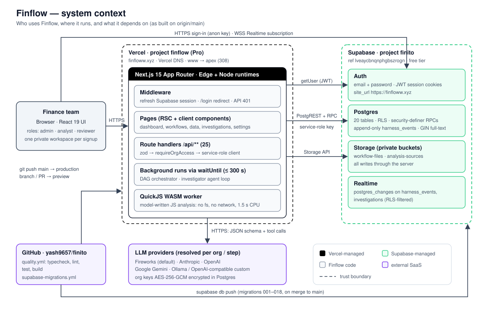
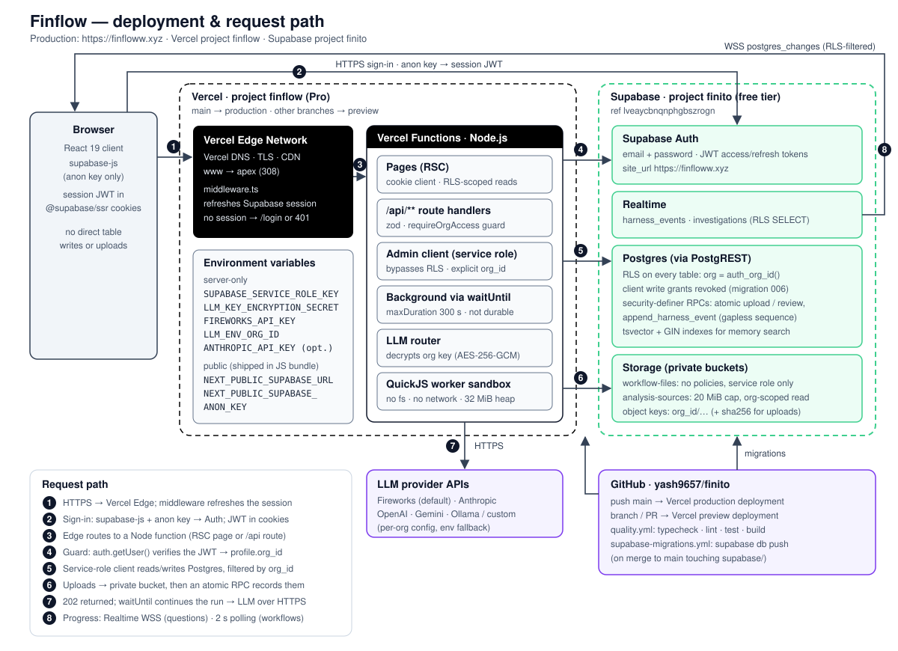
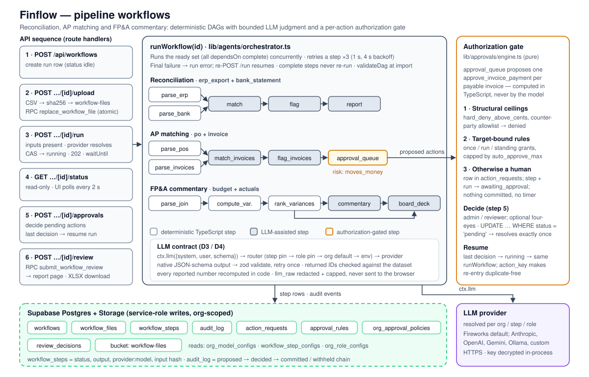
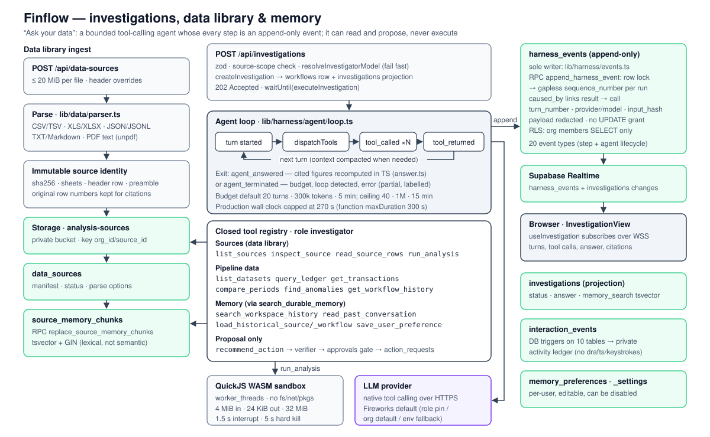

# FinFlow

Finance workflows for reconciliation, invoice review, variance analysis, and conversations over uploaded data. The chat agent can inspect unfamiliar structures, write and revise isolated JavaScript calculations, and attach methods and source evidence. People review consequential actions and reports.

**Deployment status:** strengthened pilot software, not established enterprise readiness. Read [production readiness](./docs/PRODUCTION_READINESS.md) before onboarding an organization.

Built with Next.js 15 (App Router), React 19, Tailwind v4 (dark-only), Supabase
(Postgres + Auth + Storage), and a provider-neutral model layer with native Fireworks support. See
[`PLAN.md`](./PLAN.md) for the full product/architecture spec.

## Architecture

**Live:** <https://finfloww.xyz> (`www` → apex, 308) · **Hosting:** Vercel project `finflow`, deploying `main` of `yash9657/finito` · **Data/auth:** Supabase project `finito` (`lveaycbnqnphgbszrogn`) · **DNS:** Namecheap registrar, Vercel DNS.

| Diagram | Shows |
| --- | --- |
| [System context](./docs/architecture/system-context.svg) | Users, the Next.js app on Vercel, Supabase services, LLM providers, GitHub delivery |
| [Deployment & request path](./docs/architecture/deployment.svg) | Edge → functions → Supabase topology, auth flow, key placement, numbered request path |
| [Pipeline workflows](./docs/architecture/workflow-pipeline.svg) | API sequence, the three DAGs, the authorization gate, tables written |
| [Investigations & memory](./docs/architecture/investigation-agent.svg) | Data library ingest, the bounded agent loop and tools, the append-only event stream |



### Context and goals

Finflow runs recurring finance work — bank reconciliation, invoice-to-PO matching, budget-vs-actual commentary — and open-ended questions over uploaded files. The architecture optimises for, in order: **(1) evidence** (every figure traceable to a source row, every step and decision recorded), **(2) control** (the model may judge and explain, but code computes money and people authorise consequential actions), **(3) low operating cost** for a single-operator pilot. It is explicitly *pilot* software; see [production readiness](./docs/PRODUCTION_READINESS.md) for the gates before onboarding an organisation.

### Components

| Component | Where | Responsibility |
| --- | --- | --- |
| Edge middleware (`middleware.ts`) | Vercel Edge | Refresh the Supabase session cookie on every request; redirect anonymous page requests to `/login`, return 401/503 for `/api/*` |
| Pages (`app/(app)/*`, `app/(auth)/login`) | Vercel functions (RSC) + browser | Dashboard, workflow wizard/live view/report, data library, investigations, settings (models, approvals, memory) |
| Route handlers (`app/api/**`, 25 routes) | Vercel functions (Node) | Validate with zod, authenticate via `requireOrgAccess`/`requireWorkflowAccess` (`lib/api/guard.ts`), then read/write with the service-role client scoped by `org_id` |
| DAG orchestrator (`lib/agents/`) | Same function, after the response, via `waitUntil` | Run reconciliation / AP / FP&A graphs: ready-set concurrency, 3 retries, resumable, authorization gate |
| Investigator agent (`lib/harness/agent/`) | Same, via `waitUntil` | Bounded tool-calling loop over workflow data, uploaded sources and memory; read-only except proposals |
| Event stream (`lib/harness/events.ts`) | Postgres `harness_events` | Sole writer of the append-only, gaplessly sequenced run history; streamed to the browser over Realtime |
| Approvals engine (`lib/approvals/`) | Library | Pure ceilings → rules → human decision for `moves_money` actions; persists `action_requests` |
| LLM router (`lib/llm/`) | Library | Resolve provider per step/role/org (Fireworks default; Anthropic, OpenAI, Gemini, Ollama, custom); decrypt the org key in-process; structured output + tool calling |
| QuickJS sandbox (`lib/harness/agent/sandbox/`) | `worker_threads` in the function | Execute model-written JavaScript with no fs/network, 32 MiB heap, 1.5 s interrupt, 5 s hard kill, 2 concurrent per instance |
| Supabase Auth | Supabase | Email + password, JWT access/refresh tokens in `@supabase/ssr` cookies; `site_url` = `https://finfloww.xyz` |
| Supabase Postgres | Supabase | 20 tables, RLS everywhere, security-definer RPCs for atomic writes, `tsvector` + GIN full-text memory search, interaction-ledger triggers |
| Supabase Storage | Supabase | Private buckets `workflow-files` (service role only) and `analysis-sources` (20 MiB cap, org-scoped read) |
| Supabase Realtime | Supabase | `postgres_changes` on `harness_events` and `investigations` to the investigation view |
| GitHub Actions | GitHub | `quality.yml` (typecheck, lint, test, build on PR/main); `supabase-migrations.yml` (`supabase db push` on merge to `main`) |

There are no Supabase Edge Functions, cron jobs or queues: all server code is the Next.js app.

### Request and data flow



1. **Every request** hits Vercel's edge, where middleware refreshes the Supabase session (`auth.getUser()`).
2. **Sign-in** happens browser → Supabase Auth with the anon key; the session JWT lives in cookies, so server code can read it.
3. **Route handlers** call `requireOrgAccess`: verify the JWT with Supabase Auth, load `profiles.org_id`, then hand back the **service-role** client. Every subsequent query is explicitly filtered by that `org_id` (and workflow ownership).
4. **Uploads** go server-side to a private bucket under `org_id/…` (sha256-addressed for workflow inputs) and are recorded by an atomic RPC (`replace_workflow_file`) or a `data_sources` insert with compensating object deletion.
5. **Long work** (`POST …/run`, `POST /api/investigations`) returns `202` and continues in the same function via `waitUntil` (`maxDuration = 300`; investigations cap their wall clock at 270 s in production).
6. **Progress** reaches the browser two ways: pipeline workflows poll `GET …/status` every 2 s; investigations subscribe to `harness_events`/`investigations` over Realtime (RLS limits SELECT to the user's org).

**Pipeline workflows** — deterministic parse steps feed LLM-assisted match/flag/commentary steps; the AP `approval_queue` step is `moves_money` and suspends the run (`awaiting_approval`) until each payable invoice is decided. State lives in `workflow_steps` (status, output, `provider:model`, input hash, redacted `llm_raw`) and `audit_log`.



**Investigations** — sources are parsed into immutable, hashed tables with original row numbers, stored, and indexed into `source_memory_chunks`. The agent loop chooses tools from a closed registry; every turn, call and result is an event in `harness_events` (`caused_by` links each result to its call). Final figures are recomputed in TypeScript from cited rows; `recommend_action` can only queue a proposal through the same approvals gate.



> **Not in the production path yet:** `lib/harness/loop.ts` and the Mastra-based reconciliation harness (`lib/harness/mastra.ts`, `PostgresStore` when `DATABASE_URL` is set) exist on `main` but are only exercised by `npm run harness-proof` and tests. Production pipeline runs use `lib/agents/orchestrator.ts`, which records to `workflow_steps` + `audit_log`; only investigations write `harness_events`.

### Key design decisions

| Decision | Why | Trade-off accepted |
| --- | --- | --- |
| Single Next.js app on Vercel; no separate backend | One deployable, one language, preview URLs for free | Background work is bound to a function's lifetime |
| `waitUntil` instead of a queue | Zero extra infrastructure; runs suspend at approvals with no held connection | **Not durable**: an instance crash or timeout mid-run leaves a `running` row; recovery is a manual re-POST of `/run`. Durable queue + leases is the #1 production gate |
| Service-role client in route handlers, RLS as second line | Atomic multi-table writes, uploads and RPCs without granting clients write privileges | Tenant isolation depends on every handler filtering by `org_id`; a missed filter is not caught by RLS. Mitigated by the shared guard and revoked client write grants (migration 006) |
| Two Supabase clients only (cookie/RLS and admin) | Small, auditable surface (D5) | Pages that need cross-table writes must go through an API route |
| Deterministic code for money, LLM for judgment | Model output is validated against the dataset; numbers recomputed in code | More code per workflow than a "let the model do it" design |
| Append-only `harness_events` with DB-allocated sequence | Tamper-evident trail; parallel appends can't race; Realtime for free | Write amplification (one row per event); trail and projections (`investigations`, `workflow_steps`) must be kept consistent |
| Polling (workflows) vs Realtime (investigations) | Polling is trivially correct behind one hook; Realtime suits fine-grained agent events | Two live-update mechanisms to maintain |
| Bring-your-own LLM per org, keys AES-256-GCM in Node | No vendor lock-in; plaintext never reaches SQL logs | Rotating `LLM_KEY_ENCRYPTION_SECRET` invalidates every stored key |
| QuickJS WASM for generated code | No host fs/network/packages, bounded CPU/memory, runs inside the function | JavaScript only; 2 concurrent analyses per instance; not distributed admission control |
| Postgres full-text memory, not embeddings | No vector store or embedding provider; exact citations | Lexical recall misses paraphrases |

### Failure modes

| Failure | Effect | Behaviour / recovery |
| --- | --- | --- |
| Function killed mid-run (crash, 300 s limit) | Workflow stuck in `running`; investigation without a terminal event | Status polling is read-only and cannot detect it; operator re-POSTs `/run` (errored steps reset, complete steps skipped) |
| LLM provider error / bad JSON | Step fails | Zod-validate + one corrective retry, then 3 step attempts (1 s/4 s); final failure pauses the run as `error`, resumable |
| No provider configured | Run/investigation refused | Fails fast before any rows are created; UI links to Settings → Models |
| DB error during provider resolution | — | Fails closed; never falls back to environment credentials |
| Agent runs away | Bounded | Turn/token/wall-clock/tool-call budgets + loop detection → `agent_terminated`, partial answer labelled |
| Generated code hangs or bloats | Bounded | 1.5 s interrupt, 5 s worker kill, 32 MiB heap, 24 KiB output |
| Concurrent approvals / double submit | Safe | `UPDATE … WHERE status='pending'` resolves exactly once; resume is idempotent via `action_key` |
| Supabase outage | App unusable (auth + data) | No fallback; Vercel serves only the static landing page |
| Supabase free project paused (inactivity) | All requests fail | Restore from the Supabase dashboard; consider Pro before real users |
| Migration not yet applied when code deploys | RPC/column errors | Vercel and the migration workflow deploy independently on merge; merge schema-first or in one PR |

### Security

- **Authentication:** Supabase Auth (email + password). Middleware refreshes sessions; every API route re-verifies with `auth.getUser()` (server round-trip, not just cookie decoding).
- **Authorisation:** org membership via `profiles.org_id`; roles `admin` / `analyst` / `reviewer`. Approving actions needs `admin`/`reviewer`; rules and ceilings are `admin`-only; optional four-eyes (`require_separate_approver`). New sign-ups get a private workspace (migration 008).
- **RLS:** enabled on every table, scoped by `auth_org_id()`; client write grants revoked (006), so browsers can only `SELECT` their org's rows. `org_model_configs` has no SELECT policy at all. `harness_events` has no UPDATE grant for anyone.
- **Keys:** `SUPABASE_SERVICE_ROLE_KEY`, `LLM_KEY_ENCRYPTION_SECRET`, `FIREWORKS_API_KEY`, `ANTHROPIC_API_KEY` are server-only Vercel env vars, imported only by `lib/supabase/admin.ts` / the LLM layer. Only `NEXT_PUBLIC_SUPABASE_URL` and the anon key reach the browser. Org LLM keys are AES-256-GCM encrypted in Node, exposed only as `key_last4`, and never logged or written to events.
- **Model output & generated code:** structured output validated by zod; IDs checked against the dataset; event payloads redacted and capped; generated JS isolated in QuickJS. Optional SSRF guard (`LLM_BLOCK_PRIVATE_URLS=1`) for custom base URLs.
- **Headers:** `X-Frame-Options: DENY`, `nosniff`, strict referrer, restrictive `Permissions-Policy` (`next.config.ts`). No CSP yet.
- **Gaps:** no MFA/SSO/SCIM, no rate limiting or WAF rules beyond Vercel defaults, no penetration test, retention/erasure policy undefined.

### Observability

What exists is mostly **domain** observability: `harness_events` (full agent trace with provider/model/token usage), `workflow_steps` + `audit_log` (pipeline provenance and the authorization chain), `interaction_events` (trigger-captured activity ledger), and Settings → Models → Usage (`/api/llm/usage`). **Operational** observability is limited to Vercel function logs (a handful of deliberately terse `console.error` calls that never include payloads or keys) and the Supabase dashboard. There is no tracing, error tracking, alerting or uptime check — and nothing detects a stalled `running` workflow. CI (`quality.yml`) gates typecheck, lint, tests and build.

### Cost

| Item | Plan | Notes |
| --- | --- | --- |
| Vercel | Pro (per seat / month) | Functions, edge, previews, DNS; long runs consume function duration |
| Supabase | Free | 500 MB database / 1 GB storage-class limits; no PITR; pauses after a week of inactivity. Upgrade to Pro before relying on it |
| LLM inference | Pay-per-token | Fireworks by default; orgs can bring their own keys, which bills them directly |
| Domain | Namecheap | Annual registration |

The dominant variable cost is inference; budgets per investigation (tokens, turns) are the main cost control.

### Environments

| Environment | App | Database / Auth | Notes |
| --- | --- | --- | --- |
| Local | `npm run dev` (Turbopack) on `localhost:3000` | A Supabase project from `.env.local` (`supabase/config.toml` also supports `supabase start`) | Without `waitUntil`, background runs continue in the dev server process; Ollama/localhost providers allowed |
| Preview | Vercel preview deployment per branch/PR | Whatever Supabase env vars are scoped to Preview — **verify**; if shared with production, previews touch production data | Supabase Auth redirects use `site_url` (production) |
| Production | `main` → https://finfloww.xyz | Supabase `finito` | Migrations via `supabase-migrations.yml` on merge to `main`; `LLM_ENV_ORG_ID` required for env-key fallback |

**Future option:** the owner's other apps run on a shared AWS platform (Lambda + CloudFront + Aurora Serverless v2). Moving Finflow there is planned for later; the main architectural benefit would be a durable worker/queue for runs, which is the top open gate either way.


---

## 1. Prerequisites

- Node.js 22+ (required by the PDF reader)
- A [Supabase](https://supabase.com) project (Postgres + Auth + Storage)
- A [Fireworks API key](https://fireworks.ai), or a supported alternative provider

## 2. Environment variables (§2)

Copy `.env.example` to `.env.local` and fill in the values:

```bash
cp .env.example .env.local
```

```
NEXT_PUBLIC_SUPABASE_URL=        # your Supabase project URL
NEXT_PUBLIC_SUPABASE_ANON_KEY=   # Supabase anon/public key (browser auth)
SUPABASE_SERVICE_ROLE_KEY=       # server-only; never expose to the client
LLM_KEY_ENCRYPTION_SECRET=       # required to SAVE provider API keys (AES-256-GCM, D-P2)
LLM_BLOCK_PRIVATE_URLS=          # OPTIONAL SSRF guard for custom base_urls (D-P13)
FIREWORKS_API_KEY=               # server-only open-weight model access
FIREWORKS_MODEL=accounts/fireworks/models/deepseek-v4p1-flash
FIREWORKS_INVESTIGATOR_MODEL=accounts/fireworks/models/deepseek-v4p1-flash
LLM_ENV_ORG_ID=                  # required in production to scope env credentials
ANTHROPIC_API_KEY=               # optional fallback if Fireworks is absent
```

`.env.local` is gitignored. The two `NEXT_PUBLIC_*` values are safe in the
browser; every other value is used only in server code (API route handlers + the
orchestrator) and must never be sent to the client.

- **`LLM_KEY_ENCRYPTION_SECRET`** — a random 32+ character string. Provider API
  keys are encrypted at rest with AES-256-GCM using a SHA-256 derivation of this
  secret (Plan 2, D-P2). Config-save routes **fail closed (500)** if it is unset.
  ⚠️ Rotating it invalidates every stored key — users must re-enter them under
  Settings → Models.
- **`LLM_BLOCK_PRIVATE_URLS`** — set to `1` to reject private/localhost `base_url`
  hosts at config-save time, but **only** when `NODE_ENV=production` (D-P13).
  Default off, so self-hosters can point at `http://localhost:11434` (Ollama) or a
  VPC endpoint.
- **Fireworks setup:** run `python3 scripts/configure-fireworks.py`. Paste the key at the hidden prompt; it is saved to `.env.local` with owner-only permissions. Restart the server if it was already running. Never put the key in a `NEXT_PUBLIC_` variable.
- **Environment credential scope:** `LLM_ENV_ORG_ID` must equal the workspace UUID in production. Without it the server refuses environment fallback. Per-organization provider configurations take priority; an existing Anthropic pin/default is not silently migrated by adding a Fireworks key. Set Fireworks as default and review step/role assignments under Models & usage.
- **Provider smoke proof:** `npx tsx scripts/fireworks-proof.ts` uses synthetic data to test schema output, native tool calls, and a complete tool-result round trip. It uses a small amount of billed inference. This checks API compatibility, not financial reasoning accuracy.

## 3. Apply the database schema

Apply all migration files **001 through 018 in order**. For an existing installation apply only unapplied versions. The first three establish the baseline:

1. [`001_init.sql`](./supabase/migrations/001_init.sql) — tables, RLS policies, the
   `profiles` auto-provision trigger, the seeded "Demo Org", and the private
   `workflow-files` Storage bucket.
2. [`002_llm_providers.sql`](./supabase/migrations/002_llm_providers.sql) — the
   `org_model_configs` / `workflow_step_configs` tables and the provenance columns on
   `workflow_steps`.
3. [`003_approvals.sql`](./supabase/migrations/003_approvals.sql) — the authorization
   layer: `org_approval_policies`, `approval_rules`, `action_requests`, and the
   `awaiting_approval` status values.

Migrations 004–007 add harness events, role routing, client grant restrictions, and investigations. Migration 008 adds Fireworks, tenant-bound model pins, and private workspaces for new signups. Migration 009 introduces atomic input replacement. Migration 010 introduces atomic final review decisions. Existing Demo Org memberships require operator review; migration 008 intentionally does not reassign them. Before 009, inspect duplicate `(workflow_id, file_type)` rows and resolve them against source evidence; it fails rather than deleting data automatically.

Migrations 011–012 add immutable analysis sources and conversation continuations. Migrations 013–017 add scoped memory indexes, historical workflow discovery, a private interaction ledger, contextual row search and per-file result diversity. Migration 018 makes filename components searchable while preserving exact filenames and original row citations.

Apply migrations before deploying the routes that call the new RPCs. Test against staging first and keep a database backup. Deployment options:

Migrations 011–012 add private general-purpose sources and linked conversations. Migration 013 adds indexed workspace history and private user preferences. Keep original source objects with their database metadata: history search cannot restore a deleted source.

- **CI (default).** [`.github/workflows/supabase-migrations.yml`](./.github/workflows/supabase-migrations.yml)
  runs `supabase db push` on every merge to `main` that touches `supabase/`. It needs two
  repository secrets — `SUPABASE_ACCESS_TOKEN` and `SUPABASE_DB_PASSWORD` (project ref
  defaults in the workflow and is overridable with the `SUPABASE_PROJECT_REF` variable).
  **One-time:** because `001`/`002` were originally applied by hand with `psql`, the remote
  migration-history table has no record of them, so run the workflow manually once with
  **repair_legacy_history** checked — it records those versions as applied without
  re-running their SQL, after which pushes apply only what is genuinely new.
- **Supabase CLI locally** — `supabase link --project-ref <ref>` then `supabase db push`
  (same one-time caveat: `supabase migration repair --status applied 001 002 --linked`
  first).
- **Supabase SQL editor** — open your project → SQL Editor → paste the contents of
  each file in order → Run.

## 4. Generate demo data (optional)

Deterministic sample CSVs with planted anomalies (already committed under
`demo-data/`, regenerate any time):

```bash
npm run demo-data
```

This writes the six input CSVs (ERP export, bank statement, invoices, purchase
orders, budget, actuals) plus `demo-data/expected-results.json`. Upload these in
the wizard to exercise each workflow type.

## 5. Run

```bash
npm install
npm run dev
```

Open <http://localhost:3000>. Sign up (a private workspace is created for the new user),
then **configure an LLM provider first** under **Settings → Models → Add provider**
(pick a provider, paste a key or set a base URL, "Test connection", Save; tick
"Set as organization default"). For a zero-config dev run you can instead just set
`ANTHROPIC_API_KEY` in `.env.local` — the router uses it as an implicit Anthropic
default (D-P4).

Then: **Dashboard → New workflow → pick a type → upload files → Run**. The live
view polls every 2s while the agents work. An AP run stops at the **Authorization**
panel to have each payable invoice decided (see "Per-action authorization" below) and
resumes itself once they are; then approve at the review gate to unlock the report +
audit record (Print / Save as PDF from there, or download the XLSX).

## Ask your data

Upload general files under **Your data**, inspect the parsed sheets and original rows, then start a conversation under **Ask your data**. Supported containers are CSV/TSV and other delimited text, XLS/XLSX, JSON/JSONL, TXT/Markdown, and PDFs containing embedded text. An unfamiliar column layout does not require a new hardcoded workflow. The agent can inspect, search, join and calculate with bounded JavaScript in a QuickJS WASM worker. It cannot install packages, access the host shell, browse the network, or OCR scanned documents.

Inputs retain immutable hashes, sheet names, preambles, header positions and row citations. Analysis artifacts include the generated code, code hash, selected input ranges and output. Exact decimal helpers avoid binary floating-point arithmetic; correctly executing generated code does not independently prove its accounting interpretation. The UI distinguishes analysis output from recomputed source figures.

Limits are explicit: 20 MiB per file; 10 selected files and 40 MiB combined; 20,000 rows and 500,000 cells per loaded analysis; 32 tables; 200 PDF pages. Generated computations accept 4 MiB of selected input and emit at most 24 KiB. Oversized inputs fail with guidance instead of silently analyzing a subset. Spreadsheet formulas use cached values and imported dates retain source representation. Header overrides are available on upload.

**Efficient recall:** the archive and model context are separate. Automatic memory is capped at 3,000 UTF-8 bytes; the agent retrieves short relevant excerpts and opens original evidence on demand. Indexed row search includes file/sheet/column context and limits repeated hits from one file. Private activity records cover committed app actions and best-effort authenticated page visits; drafts, passwords and keystrokes are excluded. Retrieval is lexical, not guaranteed semantic matching.

**Settings → Memory & history** controls personal preferences and automatic recall. Workspace questions, answers and uploaded files remain shared within the organization; personal preferences belong to their author. Historical answers are context, not financial truth: the agent must reload available sources before presenting fresh verified figures. Deleting a file removes future source access; previous answers and audit records can still retain excerpts. Full retention and erasure policies remain a deployment requirement.

> If no provider resolves for the org, the wizard's **Launch** and the error
> banner's **Re-run** surface the run route's inline "No LLM provider configured"
> notice, linking to **Settings → Models**.

## Per-action authorization (Plan 3)

Analysis is free; **consequential acts are not**. FinFlow does not approve a run once at
the end and call that control — anything that would move money, write a ledger, or file
externally is a first-class **action**, decided *before* it happens.

**How an action comes to exist.** A step declares a risk class from the taxonomy in
[`lib/approvals/risk.ts`](./lib/approvals/risk.ts) — `read` (the default),
`writes_ledger`, `moves_money`, `external_filing` — and, if it is not `read`, a
`proposeActions(ctx)` that computes the acts it wants to commit in **plain TypeScript**
from parsed rows and prior step outputs. The model never invents an action, an amount, or
a counterparty (D3/D-A1). Today's one non-`read` step is AP's **approval queue**:
authorizing a supplier invoice for payment. `validateDag` rejects a step whose risk and
`proposeActions` disagree, so a gate cannot be mislabelled into silence.

**How each action is decided — ceilings, then rules, then a human.**
[`lib/approvals/engine.ts`](./lib/approvals/engine.ts) is pure and deterministic:

1. **Structural ceilings (absolute).** Above `hard_deny_above_cents`, or to a name outside
   the `approved_counterparties` allowlist when the org requires one, the action is
   **denied** — the decide route refuses to resolve a denied row and no UI offers to.
   No in-band click can override an org's ceiling.
2. **Target-bound grants.** A rule matches only if the action type, target kind, and
   *every* constraint it declares hold: exact counterparty (case/whitespace normalized —
   nothing fuzzier), an inclusive amount cap, or an exact target id. `once` / `run` grants
   are locked to the run they were minted in; `standing` grants must carry a counterparty
   and/or a cap, so "approve this action type for anything" cannot be expressed. Even a
   matching rule cannot fire above `auto_approve_max_cents`.
3. **Otherwise a person decides.** With no policy row and no rules — a fresh org — that is
   *every* consequential action. Fail closed by default.

**Suspend and resume.** When any action still needs a human, the run **suspends**: the step
and workflow go `awaiting_approval`, nothing is committed, and the pending item lives in
`action_requests`. No connection is held open and no timer runs, so waiting a week costs
nothing. Decisions resolve exactly once (a conditional `UPDATE … WHERE status = 'pending'`,
so a second reviewer or a retried request is told who decided, never silently overwritten),
and clearing the last one flips the run back to `running` and re-enters the same idempotent
`runWorkflow`. Re-entry re-proposes the same `action_key`s, finds their decisions, and
proceeds — a resume never duplicates a pending item or re-asks a resolved one.

A denial or rejection **resolves** an action rather than failing the run: the step commits
everything else and records why the rest was withheld (the invoice moves to hold-for-review
carrying its authorization note).

**Segregation of duties.** Approving requires the `admin` or `reviewer` role; minting or
revoking rules and editing ceilings are `admin`-only. Turn on `require_separate_approver`
and whoever launched a run cannot authorize its actions.

**The audit artifact.** Every stage is written to `audit_log`: `action_proposed` →
`approval_requested` → `action_auto_approved` / `approval_resolved` /
`action_denied_by_ceiling` → `action_committed` or `action_withheld`, plus
`workflow_suspended` / `workflow_resumed` and `standing_rule_minted`. The report page's
audit certificate and the Excel workbook's **Authorization** sheet render the same chain
per action — type, target, counterparty, amount, risk class, outcome, the rule that
authorized it or the person who did, and the proposed/decided/committed timestamps — with
the footer stating how many of the run's consequential actions were authorized, by rule vs
by a reviewer, and how many the policy denied. Revocation is soft precisely so a past
auto-approval keeps pointing at the rule that authorized it.

**Where to configure it:** **Settings → Approvals** (ceilings, counterparty allowlist,
four-eyes toggle, standing rules) and, in a suspended run, the **Authorization** panel on
the workflow page — where approving can mint a rule pre-bound to that action's counterparty
and amount. That is the intended path from "approve every payment by hand" to "auto-approve
this vendor under $X, always ask for new payees".

> **Note for the AP demo:** with a fresh org (no policy, no rules) an AP run *will* stop and
> ask you to authorize each payable invoice — that is the feature. Approve one and tick
> "Approve and create a rule…" to watch the rest clear automatically on resume.

## Multi-provider LLM architecture (Plan 2)

Every organization configures its **own** LLM provider(s), key(s), and per-step
model choices. Agent steps never touch a provider SDK — they call a role- and
org-aware **router** (`lib/llm/router.ts`), so the same workflow can run on
Fireworks, Anthropic, OpenAI, Google Gemini, Ollama, or an OpenAI-compatible endpoint.

**Provider resolution order (D-P7).** For each LLM step, given
`(org_id, workflow_type, step_key)`:

1. An active per-step pin in `workflow_step_configs`.
2. An active role pin in `org_role_configs` (when the step declares a role).
3. The organization’s active default provider.
4. Fireworks environment configuration, then Anthropic, only when environment scope permits that organization.
5. Otherwise fail closed with a configuration error. Database errors never trigger an environment credential fallback.

Pin a step to a specific model by creating a config with that `default_model` and
assigning the step to it under **Settings → Models → Per-step model assignment**
("matching uses GPT-4.1, commentary uses Claude"). The model recorded per step is
the exact string the provider returns; the audit certificate and Excel footer list
the distinct `provider:model` pairs actually used.

**Key encryption (D-P2/D-P3).** Keys are encrypted with **AES-256-GCM in the Node
API-route process** (never `pgp_sym_encrypt`, which would put plaintext into SQL
statement logs) using a SHA-256 derivation of `LLM_KEY_ENCRYPTION_SECRET`, and
stored as `v1:<iv>:<tag>:<ciphertext>`. `org_model_configs` has **no RLS SELECT
policy** — the browser can never read it. `GET /api/llm/configs` returns everything
**except** the ciphertext, exposing only `key_last4` for display; there is no
"reveal key" path. Rotation = submit a new key for the same config. Deletion is
soft (`is_active = false`) and wipes the ciphertext (D-P15). Decrypted keys live
only inside `resolveProvider → invoke → provider` call frames — never logged,
serialized, or stored; each LLM step's raw response is redacted + capped before it
lands in `workflow_steps.llm_raw` (D-P11), which is never sent to the browser.

**Local models & the connector pattern (D-P13).** Ollama and custom endpoints must
be reachable **from the FinFlow server process**. Local dev and a self-hosted
FinFlow can point at `http://localhost:11434` (Ollama) or a VPC vLLM; the hosted
product cannot reach a customer's laptop — the Add-provider dialog says so. When
`NODE_ENV=production` **and** `LLM_BLOCK_PRIVATE_URLS=1`, config-save rejects
private/loopback `base_url` hosts (SSRF guard; default off so self-hosters work).
To use a local model behind the hosted product later, the intended extension is a
reverse proxy inside the customer network exposed via the `custom` provider's
`base_url` — an on-prem connector/webhook that is **out of scope** for this pass.

## 6. Useful scripts

| Command             | Purpose                                   |
| ------------------- | ----------------------------------------- |
| `npm run dev`       | Dev server (Turbopack)                    |
| `npm run build`     | Production build                          |
| `npm run typecheck` | `tsc --noEmit`                            |
| `npm run test`      | Unit tests (Vitest — parser, matcher, crypto, provider layer, router, DAG, orchestrator, permission engine, approval service, authorization reporting) |
| `npm run demo-data` | Regenerate `demo-data/` fixtures          |
| `npm run lint`      | ESLint                                     |

---

## Architecture notes (locked decisions, see PLAN.md)

- **D1 — Live updates via 2s polling, not SSE.** The frontend polls
  `GET /api/workflows/[id]/status` every 2s while the workflow is `running`,
  behind a single `useWorkflowStatus(id)` hook (so SSE can be swapped in later).
- **D2 / D-P6 — Background execution via `waitUntil` + a resumable DAG orchestrator.**
  `POST /api/workflows/[id]/run` verifies a provider resolves for every LLM step,
  marks the workflow `running`, kicks off `runWorkflow(id)` (`lib/agents/orchestrator.ts`)
  via `@vercel/functions` `waitUntil`, and returns `202`. The orchestrator schedules
  the **ready set** (steps whose `dependsOn` are all `complete`) concurrently, retries
  a failing step up to 3× (1s/4s backoff), and on final failure pauses the workflow —
  in-flight siblings still persist. Re-POSTing `/run` on an `error` workflow resets
  errored steps to `pending` and resumes; `complete` steps never re-run. Status polling is read-only: it cannot safely infer a dead worker. Durable queue delivery, worker leases, fencing, and abandoned-run recovery remain deployment blockers.
- **D-A3 / D-A10 — Authorization is a gate inside the orchestrator, and suspension is not
  failure.** A step whose risk class requires authorization proposes its actions, they are
  evaluated + persisted, and the step either suspends (`awaiting_approval`, nothing
  committed, `error_message` null) or runs with `ctx.approvals` and commits only what is
  authorized. Resume is the same idempotent `runWorkflow`; `action_key` makes re-entry
  duplicate-free. See "Per-action authorization" above and `PLAN-3.md` for D-A1–D-A16.
- **D3 — Hybrid matching.** Exact-rule matching (equal amounts, date windows,
  duplicates, variance arithmetic) runs in deterministic TypeScript; The configured model is used
  only for judgment (fuzzy adjudication, classification) and language (explanations,
  commentary). Every number in the report is recomputed in code from the matched
  sets and every ID the model returns is validated against the real dataset.
- **D4 / D-P1 — Provider-agnostic structured outputs.** Steps call `ctx.llm({system,
  user, schema})`; the router resolves the org's provider, requests JSON via each
  provider's strongest native mechanism (D-P9 — Anthropic `output_config`, OpenAI/Fireworks
  `json_schema`, Gemini `responseSchema`, Ollama/custom `json` + schema-in-prompt),
  then validates with Zod and retries once with the error appended. Transport is
  HTTP-first (`fetch`); only Anthropic keeps its SDK (D-P10).
- **D5 — Two Supabase clients only.** `lib/supabase/server.ts` (cookie-scoped
  `@supabase/ssr`, RLS-protected, for Server Components + auth) and
  `lib/supabase/admin.ts` (service-role, used **only** inside API route handlers and
  the orchestrator, always after an org-ownership check). No client-side writes or Storage
  access — everything mutating goes through the API routes.

### Layout

```
app/
  (auth)/login                  sign-in / sign-up
  (app)/dashboard               workflow list + launch cards
  (app)/workflows/new           upload wizard
  (app)/workflows/[id]          live agent view + review gate  (client, polls status)
  (app)/workflows/[id]/report   final report + audit certificate  (server, print)
  (app)/settings                org + members
  (app)/settings/models         LLM providers, per-step matrix, usage  (Plan 2)
  (app)/settings/approvals      ceilings, counterparty allowlist, standing rules  (Plan 3)
  (app)/settings/memory         personal preferences, automatic recall toggle
  (app)/data                    data library (upload, inspect parsed sources)
  (app)/investigations[/id]     "Ask your data" conversations  (client, Realtime)
  api/workflows/**              create / upload / run / status / review / approvals / report
  api/llm/**                    provider configs / test / step-configs / usage  (Plan 2)
  api/approvals/**              org policy / standing rules (mint + revoke)  (Plan 3)
  api/data-sources/**           upload / list / delete analysis sources
  api/investigations/**         start / list / read investigations  (Plan 5)
  api/memory/**                 search, preferences, events, reindex
components/workflow/            StepCard, WorkflowTrack, LiveWorkflowView, OutputPanel,
                                ApprovalPanel, ReviewBanner, FileDropzone, AuditTrail,
                                PrintButton
components/settings/            ModelsManager, ProviderConfigList, AddProviderDialog,
                                StepModelMatrix, UsagePanel, ApprovalsManager,
                                ApprovalPolicyEditor, StandingRulesList
lib/agents/                     dag + orchestrator + reconciliation / AP / FP&A + matching
lib/llm/                        provider.ts, router.ts, providers/*, crypto, json-schema,
                                redact, url-guard, config-service  (Plan 2)
lib/approvals/                  risk taxonomy, permission engine, service, action-types,
                                report helpers  (Plan 3)
lib/harness/                    event stream (events.ts), investigator agent + tools +
                                QuickJS sandbox (agent/), verifiers, Mastra harness (proof only)
lib/data/ · lib/memory/         source parsing + storage · durable memory index + search
lib/supabase/                   server + admin + middleware clients
lib/{types,format,audit,csv,excel}
```

### Live adaptive-memory acceptance proof

With the local app running and Fireworks configured, run `node scripts/adaptive-memory-proof.mjs`. It creates a disposable workspace, uploads synthetic unfamiliar files, checks a multi-step calculation and follow-up, and exercises recall against records explicitly dated five months earlier. It reopens originals and recomputes results; it does not wait five months or test customer data. The script incurs inference usage and cleans up its synthetic records.

`FINFLOW_EVAL_MODE=history` seeds a labeled prior question and runs only the historical-recall proof. `FINFLOW_EVAL_SCREENSHOTS=1` adds responsive browser checks. Output reports provider token totals, cached input when reported, elapsed time and the bounded initial-memory allocation. These are acceptance checks, not an enterprise accuracy or latency benchmark.
